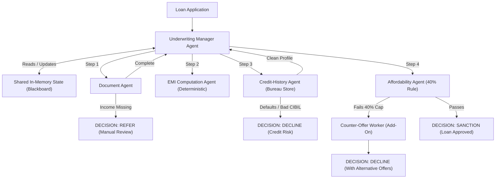

# CSE476: Agentic AI and Intelligent Automation
## Task 2 (Project 2) — Group 2: Multi-Agent Loan Underwriting System

> **Course**: CSE476 — Agentic AI and Intelligent Automation  
> **Institution**: Lovely Professional University  
> **Course Instructor**: Rohit Bharti  
> **Project Title**: Group 2 — Multi-Agent Loan Underwriting System  
> **Framework**: Microsoft Semantic Kernel  
> **Architecture**: Manager-Worker Delegation with Shared In-Memory Blackboard  

---

## 1. Project Overview & Deliverables Roster

This repository provides an enterprise-grade multi-agent loan underwriting system designed and built to satisfy all requirements of **CSE476 Academic Task 2 (Project 2)**. The system evaluates retail/commercial loan applications and deterministically produces an underwriting verdict: **`SANCTION`**, **`DECLINE`**, or **`REFER`**, alongside computed reducing-balance EMI, debt-to-income affordability metrics, credit risk classifications, viable counter-offers, and a formal one-paragraph justification.

### Complete Deliverables Map
- **Source Code (One Module Per Agent)**:
  - `agents/document_agent.py` — Ingestion & Completeness Specialist
  - `agents/emi_agent.py` — Deterministic Reducing-Balance Math Specialist
  - `agents/credit_agent.py` — Credit Bureau & Delinquency Specialist
  - `agents/affordability_agent.py` — Stated Income & Debt-To-Income Specialist
  - `agents/counter_offer_agent.py` — Alternative Loan Proposal Worker (*Group-of-3 Add-On*)
  - `agents/underwriting_manager.py` — Central Coordinator (Supports Local Qwen 3 Agent via Ollama)
- **Local Web Application & One-Click Launcher**:
  - `app.py` — Interactive Web Application (FastAPI + Modern UI) with automatic browser launch
  - `launch_app.bat` — Windows 1-click batch launcher
  - `launch_web_app.py` — Convenience launcher script
- **Tools (At Least Two Real Plain Python Functions Per Agent)**:
  - `tools/document_tools.py`
  - `tools/emi_tools.py`
  - `tools/affordability_tools.py`
  - `tools/credit_tools.py`
  - `tools/counter_offer_tools.py`
- **Data & In-Memory Prior Record Store**:
  - `data/bureau_records.json` — In-memory bureau record store
  - `data/sample_applications.json` — Benchmark test cases
- **Automated Tests Covering All Scenarios**:
  - `tests/test_underwriting.py` (Pytest suite testing Sanction, Decline, Refer, and Credit Risk)
- **Interactive Runnable Demo & Notebook**:
  - `run_demo.py` — Command-line runner printing step-by-step multi-agent trace
  - `notebooks/demo.ipynb` — Fully executed Jupyter Notebook with rendered tables and traces
- **Append-Only Run Log**:
  - `run_log.md` — Immutable audit log of every evaluated applicant
- **Architecture Documentation & Diagram**:
  - `docs/architecture.md` & `docs/architecture_diagram.png`

---

## 2. Agent Roster

Every agent is developed as an isolated module with one clear role and two dedicated tools:

| Agent Module | Primary Role | Tools Implemented |
| :--- | :--- | :--- |
| **`DocumentAgent`** (`document_agent.py`) | Application parsing and document validation. Detects missing income to trigger referral. | 1. `validate_application_completeness`<br>2. `extract_financial_fields` |
| **`EMIComputationAgent`** (`emi_agent.py`) | Deterministic mathematical calculation of monthly reducing-balance EMI and interest breakdown. | 1. `compute_reducing_balance_emi`<br>2. `generate_amortization_schedule` |
| **`CreditHistoryAgent`** (`credit_agent.py`) | Queries in-memory bureau history, extracts CIBIL scores, and flags defaults/delinquencies. | 1. `query_bureau_records`<br>2. `assess_credit_risk` |
| **`AffordabilityAgent`** (`affordability_agent.py`) | Applies the stated income rule (EMI $\le$ 40% of net income) and checks total debt-to-income (DTI). | 1. `check_affordability_rule`<br>2. `calculate_debt_to_income_ratio` |
| **`CounterOfferAgent`** (`counter_offer_agent.py`) | *Group-of-3 Add-On*: Formulates viable alternatives if requested amount fails the affordability cap. | 1. `calculate_max_eligible_loan_amount`<br>2. `propose_extended_tenure_option` |
| **`UnderwritingManager`** (`underwriting_manager.py`) | Orchestrator delegating tasks to specialists, maintaining shared state, and synthesizing defensible decisions. | Orchestrates pipeline, enforces gates, appends to `run_log.md`. |

---

## 3. Architecture & Why It Fits

The project implements the **Manager-Worker Delegation** pattern coupled with an **In-Memory Shared Blackboard (`SharedUnderwritingRecord`)**.

### Why This Architecture Fits Loan Underwriting:
1. **Procedural Precedence & Gating**: Financial underwriting requires strict serial validation. If mandatory income documents are absent, computing EMI or running bureau checks is wasteful and legally hazardous. The Manager halts the pipeline at Stage 1.
2. **Deterministic Computation Over LLM Math**: LLMs struggle with compounding interest calculations. In our architecture, the `EMIComputationAgent` calls a pure Python deterministic function implementing the exact reducing-balance formula:
   $$EMI = \frac{P \cdot r \cdot (1+r)^n}{(1+r)^n - 1}$$
3. **Auditability & Regulatory Defense**: Every agent writes structured trace entries into the shared blackboard. The manager aggregates these entries into a defensible one-paragraph justification and writes them to an append-only log.



---

## 4. What the Memory & Retrieval Holds

- **Shared State Blackboard (`SharedUnderwritingRecord`)**: Held in Python heap memory during execution. Carries raw input, validated financial floats, computed EMI figures, amortization summaries, bureau credit scores, debt-to-income percentages, and an ordered list of `AgentTraceEntry` objects.
- **In-Memory Prior Record Store (`data/bureau_records.json`)**: Emulates the national credit bureau (e.g., CIBIL/Experian). Retains historical applicant files with credit scores, past write-offs, active loans, and repayment remarks.
- **Append-Only Run Log (`run_log.md`)**: File-based persistent log recording every execution event with UTC timestamps, decision badges, ratios, and audit traces.

---

## 5. One Honest Failure Handled

### The "Missing Income Hallucination & Default Assumption" Trap
In naive agent pipelines, when an applicant leaves the `monthly_income` field blank, common failures include:
- The parser coerces `None` to `0.0`, triggering division-by-zero crashes or erroneous zero-income debt ratios.
- An LLM agent hallucinates an estimated salary based on employment title or applicant demographics.
- In underwriting, making ungrounded assumptions on income leads to severe credit non-compliance.

**How Our System Handles It:**  
The `DocumentAgent` checks specifically for missing or non-positive income. When detected, the `UnderwritingManager` halts immediately, refusing to call the EMI or Bureau specialists. The decision is categorized as **`REFER`**, and the system outputs a formal justification stating:
> *"Rather than making an assumption or hallucinating an income figure, system governance mandates referring the case to human operations for physical salary slip verification."*

---

## 6. Group-of-3 Add-On: Counter-Offer Specialist Worker

When an applicant with acceptable credit standing fails the 40% affordability threshold, rather than simply rejecting the customer, the **`CounterOfferAgent`** solves two inverse optimization problems:
1. **Maximum Affordable Loan Amount**: Inverts the reducing-balance equation to compute the exact maximum loan principal that fits within the 40% income cap under the requested tenure:
   $$P_{\max} = \frac{EMI_{\text{cap}} \cdot ((1+r)^n - 1)}{r \cdot (1+r)^n}$$
2. **Extended Tenure Option**: Iterates tenure upwards (in 6-month increments up to 84 months) to identify the shortest viable repayment period that brings the requested loan amount under the 40% income cap.

---

## 7. How to Run the Project

### 1. Launch the Interactive Local Web Application (Recommended)
Run the executable script:
```powershell
$env:PYTHONPATH = "f:\Agenetic-AI"
python app.py
```
*(Or double-click `launch_app.bat` in Windows Explorer).*  
The script starts the local server and **automatically opens your web browser** to `http://127.0.0.1:8000`. You can:
- Test all 4 benchmark scenarios with 1 click.
- Run underwriting with the **Local Qwen 3 Agent** (via Ollama on your machine) or the Deterministic Rule Engine.
- Inspect the step-by-step multi-agent execution trace and justification in real-time.

### 2. Run Automated Pytest Suite
```powershell
$env:PYTHONPATH = "f:\Agenetic-AI"
pytest tests/test_underwriting.py -v
```
*Expected Result: 4 passed.*

### 3. Run Console Interactive Trace Demo
```powershell
$env:PYTHONPATH = "f:\Agenetic-AI"
python run_demo.py
```

### 4. Open Runnable Demo Notebook
```powershell
jupyter lab notebooks/demo.ipynb
```

---

## 8. Test Scenario Summary

| Scenario | Applicant | Verified Income | Requested Loan | Computed EMI | CIBIL | Final Verdict | Core Reason |
| :--- | :--- | :--- | :--- | :--- | :--- | :--- | :--- |
| **1. Sanction** | Alice Sharma | $125,000 | $500,000 (36m) | $16,251.22 | 785 | **`SANCTION`** | EMI is 13.0% of income ($\le$ 40%), Prime credit score, 0 defaults. |
| **2. Decline** | Bob Mehta | $35,000 | $1,200,000 (24m) | $55,651.25 | 740 | **`DECLINE`** | EMI is 159% of income (fails 40% rule). Proposes counter-offer of $301,880.01 max loan. |
| **3. Refer** | Charlie Verma | *Missing* | $300,000 (24m) | *N/A* | 710 | **`REFER`** | Halts at Document Agent: missing income cannot be assumed or hallucinated. |
| **4. Decline** | David Khan | $95,000 | $200,000 (24m) | $9,275.21 | 590 | **`DECLINE`** | Credit risk: CIBIL 590 below 650 cut-off, 2 past defaults recorded. |
