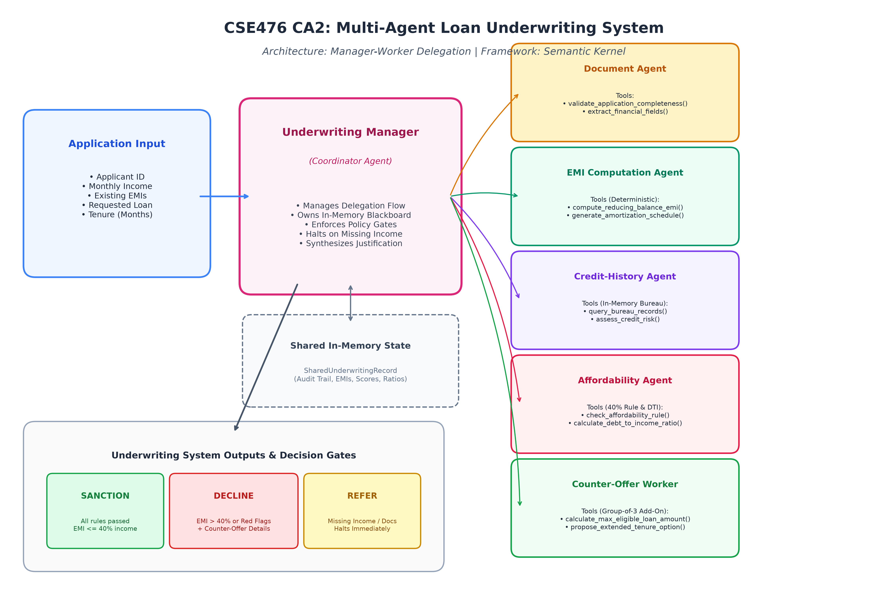
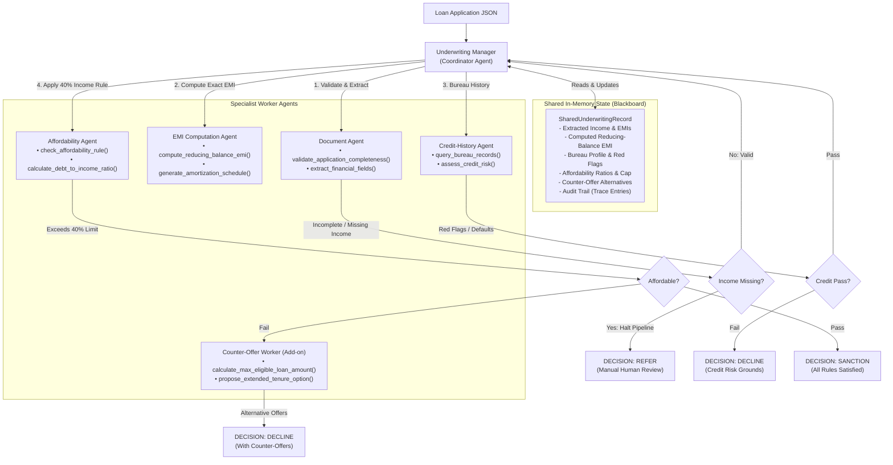

# System Architecture: Multi-Agent Loan Underwriting System

## Overview
This document specifies the multi-agent system architecture developed for **CSE476 CA2 Project 2 (Group 2: Multi-Agent Loan Underwriting System)**. Built with Microsoft **Semantic Kernel**, the system automates commercial and retail loan underwriting through **Manager-Worker Delegation** coordinated around a shared in-memory blackboard.

---

## 1. Architectural Pattern: Manager-Worker Delegation

### Why Manager-Worker Delegation Fits
Loan underwriting requires strict procedural integrity and governance:
1. **Deterministic Precedence**: Document completeness must gate subsequent math and credit bureau inquiries. An incomplete application must halt immediately without invoking downstream specialists.
2. **Specialized Accountability**: Computing reducing-balance EMI requires exact mathematical algorithms, whereas evaluating credit risk requires credit bureau lookup, and affordability enforcement requires applying bank debt-to-income policy caps. Isolating these responsibilities into distinct specialist agents ensures testability and prevents cross-domain hallucination.
3. **Audit Trail & Governance**: A central manager maintains end-to-end visibility over the shared state, synthesizes specialist findings into a single defensible verdict, and records every step into an immutable audit log.

---

## 2. Agent Roster & Tool Inventory

Each agent is implemented as an independent Python module with at least two dedicated tools written as plain Python functions decorated as Semantic Kernel `@kernel_function` plugins:

| Agent Module | Role | Tool 1 | Tool 2 |
| :--- | :--- | :--- | :--- |
| **`DocumentAgent`** | Ingestion & validation | `validate_application_completeness` (verifies required fields; detects missing income) | `extract_financial_fields` (extracts normalized income, debts, amount, tenure) |
| **`EMIComputationAgent`** | Deterministic loan math | `compute_reducing_balance_emi` (standard reducing-balance mathematical formula) | `generate_amortization_schedule` (month-by-month principal and interest split) |
| **`CreditHistoryAgent`** | Bureau risk evaluation | `query_bureau_records` (queries in-memory prior record store) | `assess_credit_risk` (flags defaults, write-offs, and CIBIL cutoffs) |
| **`AffordabilityAgent`** | Underwriting policy gate | `check_affordability_rule` (enforces proposed EMI $\le$ 40% net monthly income) | `calculate_debt_to_income_ratio` (evaluates total leverage and debt headroom) |
| **`CounterOfferAgent`** | Add-on synthesis worker | `calculate_max_eligible_loan_amount` (solves for max principal under 40% cap) | `propose_extended_tenure_option` (solves for extended tenure up to 84 months) |
| **`UnderwritingManager`** | Central orchestrator | Orchestrates delegation pipeline; maintains shared memory; halts on missing income; produces one-paragraph justification | Writes every execution event to append-only `run_log.md` |

---

## 3. Memory & Storage Architecture

1. **Shared In-Memory State (`SharedUnderwritingRecord`)**:
   - Holds the live execution context for the active applicant.
   - Every specialist agent receives this record, invokes its local tools, writes findings back, and appends a structured `AgentTraceEntry`.
   - Thread-safe, reproducible, and zero database setup required.
2. **In-Memory Prior Record Store (`data/bureau_records.json`)**:
   - Represents the credit bureau database.
   - Contains simulated credit history, CIBIL scores, active loans, and default records for returning and new applicants.
3. **Append-Only Run Log (`run_log.md`)**:
   - Captures timestamped markdown logs recording every application evaluated, the multi-agent step trace, the computed metrics, and the formal justification.

---

## 4. One Honest Failure Handled

### The Hallucination & Defaulting Assumption Trap
A common failure in naive AI agent workflows is that when an applicant fails to provide income information, an LLM or permissive parser defaults the missing field to `0` or hallucinates a median income from demographic text. 
- In loan underwriting, defaulting missing income to $0 causes an erroneous mathematical crash (division by zero in DTI) or a generic decline, whereas assuming an income risks issuing an unbacked loan.
- **Our Handling**: The `DocumentAgent` explicitly distinguishes between a verified 0 income and a missing/null value. When missing, the pipeline halts immediately with a `REFER` status. Downstream computation and credit bureaus are not called, and the system synthesizes a policy-backed justification stating that physical salary slips must be inspected by a human underwriter.
